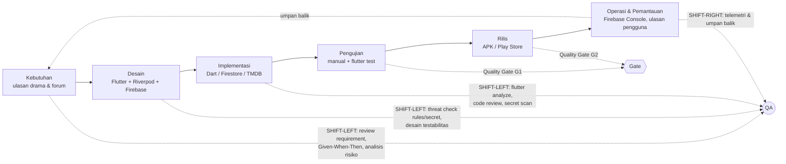
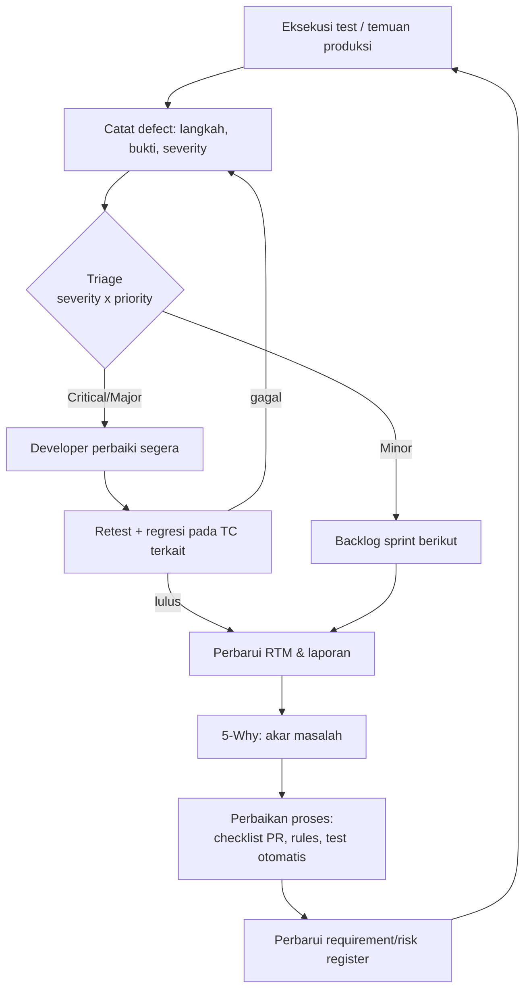

# P02 — QA Lifecycle & Feedback Loop

## 1. Alur SDLC dengan titik QA (Filmory)

| Fase | Aktivitas QA | Artefak |
|---|---|---|
| Kebutuhan | Tinjau & perbaiki requirement, tulis *acceptance criteria*, nilai risiko | P03 |
| Desain | Pastikan aturan akses (Firestore/Storage rules) ada & dapat diuji; pisahkan rahasia dari kode | P04 |
| Implementasi | `flutter analyze`, tinjauan kode PR, pemindaian rahasia | Checklist gate G0 |
| Pengujian | Eksekusi 21 test case, uji negatif & batas, laporan defect | P05–P07 |
| Rilis | Audit akhir & keputusan Go/No-Go | P08 |
| Operasi | Pantau crash, penggunaan Firestore/TMDB, ulasan pengguna | Sumber *evidence* shift-right |

## 2. Aktivitas *Shift-Left* (≥2)

| # | Aktivitas | Cara dilakukan pada Filmory | Cacat yang dapat dicegah lebih awal |
|---|---|---|---|
| SL-1 | **Review requirement + Given-When-Then** sebelum coding | Menyimpulkan 9 requirement (dalam ruang lingkup) dari kode, memperjelas kalimat ambigu (mis. "bisa menulis review" → rating 0.5–5, teks wajib, 1 review/user/drama) | D-04 (review ganda), D-02 (kriteria "sukses" yang jelas) |
| SL-2 | **Pemindaian rahasia & tinjauan konfigurasi** saat commit | Aturan pra-commit (mis. gitleaks) + `.gitignore` untuk `.env` | D-05 (key TMDB ter-commit) |
| SL-3 | **Analisis statis & tinjauan kode** | `flutter analyze`; checklist PR: "setiap `onPressed` terhubung", "nilai kembalian error dipakai" | D-01 (handler kosong), D-02 (nilai kembalian diabaikan) |
| SL-4 | **Test otomatis tingkat unit** untuk validasi | Test fungsi validasi & mock `TmdbService` | D-03 (URL tanpa encoding), D-06 |

## 3. Sumber *evidence* *Shift-Right* (≥1)

| # | Sumber | Isi bukti | Status pada Filmory |
|---|---|---|---|
| SR-1 | **Firebase Console** (Authentication, Firestore Data & Usage) | Memverifikasi dampak aksi: dokumen `reviews`, `forum_threads/*/posts` yatim (D-08), field `fcmTokens` kosong (D-10), lonjakan *read* karena `updateUsername` (D-09) | Tersedia → dipakai pada praktikum |
| SR-2 | **Firebase Crashlytics / Analytics** | Laporan crash & funnel (login→review) | Belum terpasang → direkomendasikan |
| SR-3 | Ulasan & rating toko aplikasi / umpan balik pengguna | Keluhan "tidak bisa hapus review", "email reset tidak datang" | Belum ada (aplikasi belum dirilis) |
| SR-4 | Dasbor kuota TMDB | Pemakaian API abnormal akibat key bocor | Direkomendasikan |

## 4. Rancangan *Quality Gate*

| Gate | Titik | Kriteria lulus (semua wajib) | Pemilik |
|---|---|---|---|
| **G0 – Merge ke `main`** | Sebelum merge PR | `flutter analyze` 0 error; tidak ada rahasia terdeteksi; `flutter test` lulus; PR direview ≥1 orang | Developer + Reviewer |
| **G1 – Siap uji (Entry)** | Sebelum eksekusi test | Build berjalan; akun dummy siap; test case disetujui | QA Lead |
| **G2 – Siap rilis (Exit)** | Sebelum rilis | 100% TC prioritas High dieksekusi; ≥90% lulus total; 0 defect Critical; 0 defect Major tanpa *workaround*; seluruh requirement *Must* tercakup RTM | QA Lead → Product Owner |

## 5. Alur umpan balik (*feedback loop*)

**Waktu respons yang disepakati:** Critical ≤ 1 hari, Major ≤ 3 hari, Minor/Low masuk backlog; setiap defect Major wajib melalui analisis akar masalah (5-Why, P07) dan menghasilkan satu perbaikan proses.
