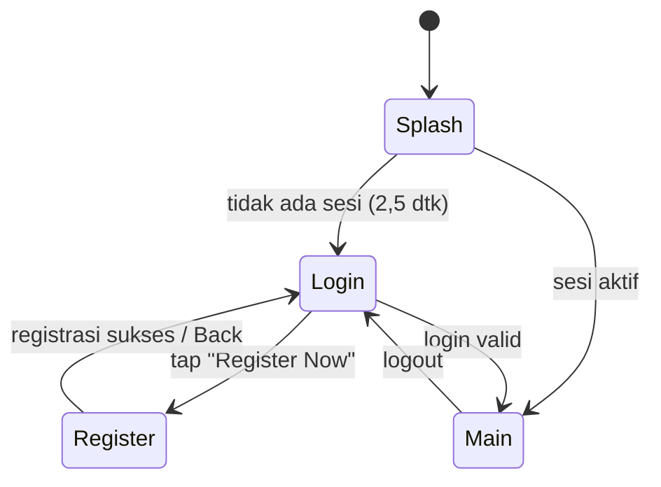

# P06 — Black-Box Test Design & Execution

> **Status hasil:** seluruh 21 test case telah dieksekusi dan hasilnya dikonfirmasi penguji (kolom *Terverifikasi_Screenshot* di CSV). Hasil: 18 PASS, 3 FAIL. Rincian *actual* pada TC yang gagal masih memuat analisis kode sebagai penjelasan penyebab.

## 1. Ringkasan penerapan teknik

| Teknik | Syarat minimum | Total TC (semua) | TC wajib-bukti | Daftar TC |
|---|---|---|---|---|
| Equivalence Partitioning | ≥3 (valid & invalid) | 8 | 8 | TC-01, TC-02, TC-06, TC-07, TC-10, TC-14, TC-17, TC-20 |
| Boundary Value Analysis | ≥3 (bawah, pada, atas) | 3 | 3 | TC-07, TC-08, TC-09 |
| Decision Table | ≥3 (≥2 kondisi, 4 kombinasi) | 5 | 5 | TC-01, TC-02, TC-03, TC-04, TC-05 |
| State Transition | ≥3 (≥3 state; diizinkan & dilarang) | 8 | 8 | TC-07, TC-11, TC-12, TC-13, TC-15, TC-16, TC-18, TC-19 |
| Kondisi negatif/invalid | ≥4 | 9 | 9 | TC-03, TC-04, TC-05, TC-06, TC-09, TC-10, TC-14, TC-20, TC-21 |

Total test case: **21** (syarat ≥12), seluruhnya wajib-bukti. Satu TC dapat memuat lebih dari satu teknik.

## 2. Equivalence Partitioning (EP)

| Input | Kelas valid | Kelas invalid | TC |
|---|---|---|---|
| Email (Login) | V1: terdaftar & format benar | I1: format benar tapi tidak terdaftar; I2: kosong | TC-01 (V1), TC-06 (I1), TC-03 (I2) |
| Password (Login) | V1: sesuai akun | I1: salah; I2: kosong | TC-01, TC-02, TC-04 |
| Email (Register) | V1: format benar & belum dipakai | I1: format salah (`budi@@mail`) | TC-07 (V1), TC-10 (I1) |
| Teks review | V1: ≥1 karakter non-spasi *(tidak diuji, di luar 21 TC)* | I1: kosong | TC-14 (I1) |
| Kata kunci pencarian | V1: judul ada *(tidak diuji)* | I1: berisi karakter khusus `&` | TC-20 |
| Aksi hapus review (fungsional) | V1: review milik sendiri | — | TC-17 |

## 3. Boundary Value Analysis (BVA)

**a. Panjang password registrasi** (batas minimum Firebase Auth = 6)

| Nilai uji | Posisi | Panjang | Hasil diharapkan | TC |
|---|---|---|---|---|
| `Ab1#x` | tepat di bawah batas | 5 | Ditolak (weak-password) | TC-09 |
| `Ab1#xy` | tepat pada batas | 6 | Diterima | TC-08 |
| `Ab1#xyz` | tepat di atas batas | 7 | Diterima, kembali ke Login | TC-07 |

**b. Rating review** — tidak diuji dalam 21 TC (rating min 0.5 / maks 5.0 dicatat sebagai *blind spot* di P08).

## 4. Decision Table

**DT-1 — Login** (kondisi: C1 email terisi, C2 password terisi, C3 kredensial cocok)

| Aturan | C1 | C2 | C3 | Aksi/hasil diharapkan | TC |
|---|---|---|---|---|---|
| R1 | Y | Y | Y | Masuk ke MainScreen | TC-01 |
| R2 | Y | Y | N | Snackbar error Firebase; tetap di Login | TC-02 |
| R3 | N | Y | – | Snackbar 'Email and password cannot be empty.' | TC-03 |
| R4 | Y | N | – | Snackbar 'Email and password cannot be empty.' | TC-04 |
| R5 | N | N | – | Snackbar 'Email and password cannot be empty.' | TC-05 |

## 5. State Transition

**Mesin state autentikasi** (state: `Splash`, `Login`, `Register`, `Main`):

| # | Dari → Ke | Pemicu | Jenis | Hasil diharapkan | TC |
|---|---|---|---|---|---|
| T1 | Splash → Main | Buka ulang dengan sesi aktif | Diizinkan | MainScreen | *tidak diuji (di luar 21 TC)* |
| T2 | Register → Login | Registrasi sukses | Diizinkan | Kembali ke Login, tidak auto-login | TC-07 |
| T3 | Main → Login | Logout | Diizinkan | LoginScreen | TC-11 |
| T4 | Login → Main | Login dengan kredensial salah | **Dilarang** | Tetap di Login + error | TC-02 |
| T5 | Main → Login | Tombol Back sistem | **Dilarang** | Tidak membuka Login; app keluar | TC-12 |
| T6 | Login → Main | Back setelah logout | **Dilarang** | MainScreen tidak tampil | TC-13 |

**Mesin state lain:** Like review (`BelumSuka ↔ Suka`: TC-15, TC-16) dan Watchlist (`BelumDisimpan ↔ Tersimpan`: TC-18, TC-19).

## 6. Test case kondisi negatif/invalid (≥4)
TC-03, TC-04, TC-05, TC-06, TC-09, TC-10, TC-14, TC-20, TC-21 — total **9** TC; yang wajib-bukti: TC-03, TC-04, TC-05, TC-06, TC-09, TC-10, TC-14, TC-20, TC-21.

## 7. Eksekusi & evidence (ringkas)

| TC | Judul | Teknik | Expected | Actual | Status | Evidence | Wajib |
|---|---|---|---|---|---|---|---|
| TC-01 | Login valid | EP (valid); Decision Table R1 | MainScreen (Home) tampil; tidak ada pesan error. | Sesuai expected result (dikonfirmasi penguji). | PASS | `evidence/TC-01_login_valid.png` | Ya |
| TC-02 | Login dengan password salah | EP (invalid); Decision Table R2 | Snackbar berisi pesan error Firebase (kredensial salah); tetap di halaman Login. | Sesuai expected result (dikonfirmasi penguji). | PASS | `evidence/TC-02_login_password_salah.png` | Ya |
| TC-03 | Login dengan email kosong | Decision Table R3; Negatif | Snackbar 'Email and password cannot be empty.'; tidak ada panggilan ke Firebase. | Sesuai expected result (dikonfirmasi penguji). | PASS | `evidence/TC-03_login_email_kosong.png` | Ya |
| TC-04 | Login dengan password kosong | Decision Table R4; Negatif | Snackbar 'Email and password cannot be empty.' | Sesuai expected result (dikonfirmasi penguji). | PASS | `evidence/TC-04_login_password_kosong.png` | Ya |
| TC-05 | Login dengan kedua field kosong | Decision Table R5; Negatif | Snackbar 'Email and password cannot be empty.' | Sesuai expected result (dikonfirmasi penguji). | PASS | `evidence/TC-05_login_semua_kosong.png` | Ya |
| TC-06 | Login dengan email tidak terdaftar | EP (invalid); Negatif | Snackbar pesan error Firebase; tetap di Login. | Sesuai expected result (dikonfirmasi penguji). | PASS | `evidence/TC-06_login_email_tidak_terdaftar.png` | Ya |
| TC-07 | Register valid (password 7 karakter, batas atas valid) | BVA (di atas batas); EP (valid); State Transition (Register→Login) | Snackbar hijau 'Registrasi berhasil! Silakan login.'; kembali ke Login; pengguna TIDAK otomatis login. | Sesuai expected result (dikonfirmasi penguji). | PASS | `evidence/TC-07_register_pw7_valid.png` | Ya |
| TC-08 | Register password tepat 6 karakter (batas minimum) | BVA (pada batas) | Registrasi berhasil (batas minimum Firebase = 6). | Sesuai expected result (dikonfirmasi penguji). | PASS | `evidence/TC-08_register_pw6_batas.png` | Ya |
| TC-09 | Register password 5 karakter (di bawah batas) | BVA (di bawah batas); Negatif | Registrasi ditolak; snackbar pesan Firebase (password minimal 6 karakter); akun tidak terbentuk. | Sesuai expected result (dikonfirmasi penguji). | PASS | `evidence/TC-09_register_pw5_ditolak.png` | Ya |
| TC-10 | Register dengan format email tidak valid | EP (invalid); Negatif | Snackbar pesan Firebase (email badly formatted); akun tidak terbentuk. (Aplikasi tidak memvalidasi format email di sisi klien.) | Sesuai expected result (dikonfirmasi penguji). | PASS | `evidence/TC-10_register_email_invalid.png` | Ya |
| TC-11 | Logout kembali ke Login | State Transition (Main→Login, diizinkan) | LoginScreen tampil; sesi berakhir. | Sesuai expected result (dikonfirmasi penguji). | PASS | `evidence/TC-11_logout.png` | Ya |
| TC-12 | Tombol Back di MainScreen tidak membuka Login (transisi dilarang) | State Transition (Main→Login via Back, dilarang) | Aplikasi keluar/ke home Android; halaman Login TIDAK muncul sementara sesi masih aktif. | Sesuai expected result (dikonfirmasi penguji). | PASS | `evidence/TC-12_back_dari_main.png` | Ya |
| TC-13 | Back di Login setelah logout tidak membuka MainScreen (transisi dilarang) | State Transition (Login→Main via Back, dilarang) | MainScreen tidak pernah tampil tanpa login; app keluar atau tetap di Login. | Sesuai expected result (dikonfirmasi penguji). | PASS | `evidence/TC-13_back_dari_login_setelah_logout.png` | Ya |
| TC-14 | Kirim review dengan teks kosong | EP (invalid); Negatif | Snackbar 'Review text cannot be empty.'; review tidak tersimpan. | Sesuai expected result (dikonfirmasi penguji). | PASS | `evidence/TC-14_review_teks_kosong.png` | Ya |
| TC-15 | Like review (Belum suka → Suka) | State Transition (NotLiked→Liked) | Ikon hati menjadi merah solid; hitungan bertambah 1. | Sesuai expected result (dikonfirmasi penguji). | PASS | `evidence/TC-15_like_review.png` | Ya |
| TC-16 | Unlike review (Suka → Belum suka) | State Transition (Liked→NotLiked) | Ikon kembali outline; hitungan berkurang 1. | Sesuai expected result (dikonfirmasi penguji). | PASS | `evidence/TC-16_unlike_review.png` | Ya |
| TC-17 | Hapus review milik sendiri dari Profil | EP (valid); Fungsional | Muncul konfirmasi lalu review hilang dari daftar dan dari halaman detail drama. | [Dikonfirmasi penguji: gagal; penyebab menurut analisis kode] Handler onPressed kosong ('// Delete logic') → tidak ada perubahan. | FAIL | `evidence/TC-17_hapus_review_profil.png` | Ya |
| TC-18 | Tambah drama ke Watchlist | State Transition (NotSaved→Saved) | Ikon menjadi bookmark solid emas; drama muncul di tab Watchlist. | Sesuai expected result (dikonfirmasi penguji). | PASS | `evidence/TC-18_watchlist_tambah.png` | Ya |
| TC-19 | Hapus drama dari Watchlist | State Transition (Saved→NotSaved) | Ikon kembali outline; drama hilang dari Watchlist. | Sesuai expected result (dikonfirmasi penguji). | PASS | `evidence/TC-19_watchlist_hapus.png` | Ya |
| TC-20 | Cari dengan karakter khusus '&' | EP (karakter khusus); Negatif | Hasil mencerminkan seluruh kata kunci 'Love & War' dan terbatas pada drama Korea. | [Dikonfirmasi penguji: gagal; penyebab menurut analisis kode] '&' memutus parameter query → pencarian hanya 'Love ' dan hasil bisa tidak relevan/non-Korea. Konfirmasi dengan screenshot. | FAIL | `evidence/TC-20_search_karakter_khusus.png` | Ya |
| TC-21 | Reset password saat offline | Error guessing; Negatif | Pesan error (jaringan gagal); TIDAK ada pesan sukses. | [Dikonfirmasi penguji: gagal; penyebab menurut analisis kode] Snackbar hijau 'Password reset email sent…' tetap tampil karena nilai error dari service diabaikan. | FAIL | `evidence/TC-21_reset_password_offline.png` | Ya |

Detail lengkap (precondition, langkah, data, oracle) ada di `test-cases/05_Test_Cases.csv`.